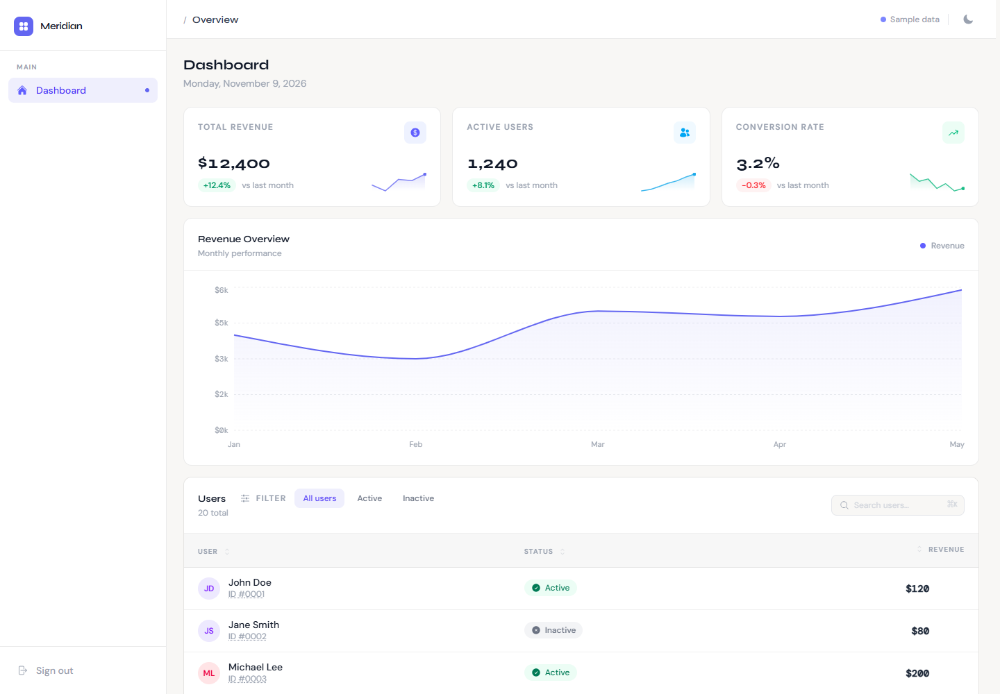
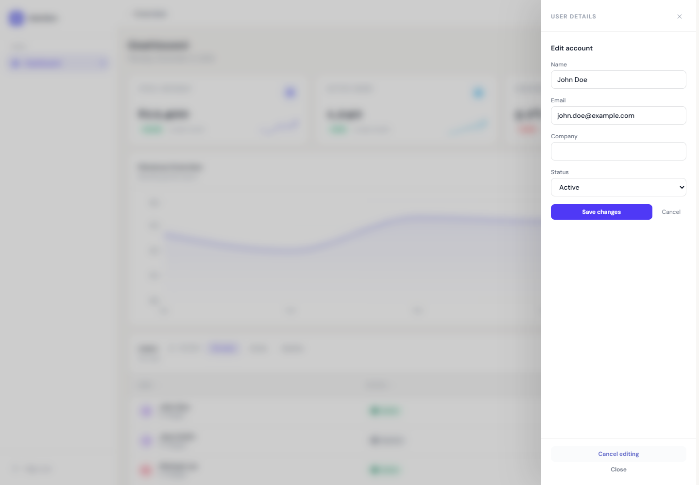
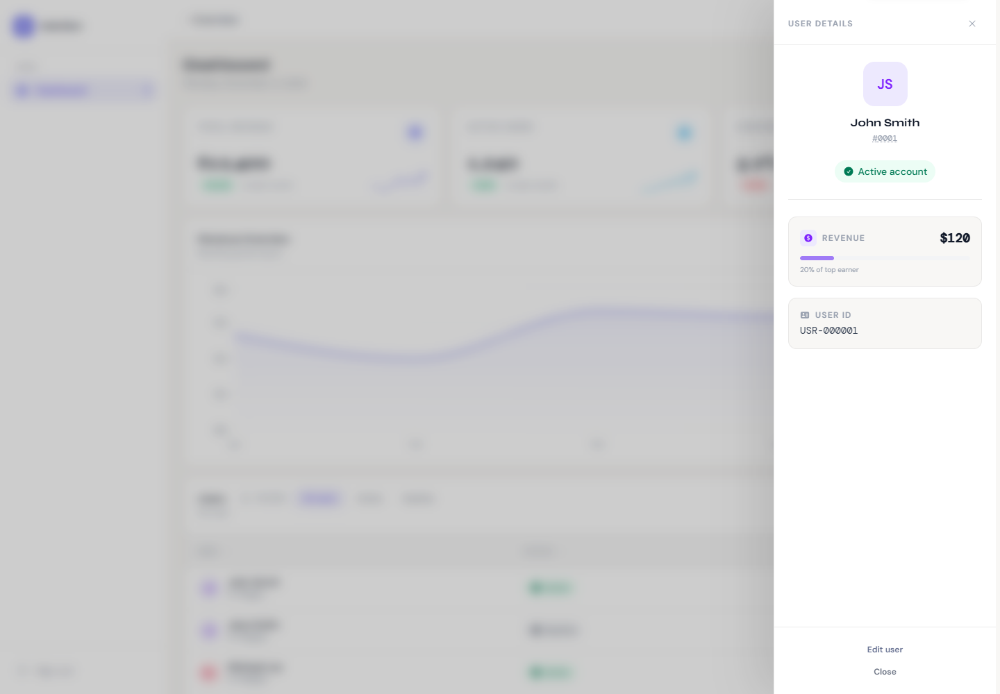

# Meridian — SaaS Analytics Dashboard

A frontend portfolio project for exploring analytics and user-management workflows with React 19, TypeScript, and Tailwind CSS v4. It demonstrates feature-based architecture, server-state patterns, accessible interactions, and UI feedback for async operations.

**Live demo:** [saas-dashboard-sazzad15.netlify.app](https://saas-dashboard-sazzad15.netlify.app/)  
**Credentials:** `admin@example.com` / `123456`

---

## Screenshots

### Dashboard



### Edit user



### Saved state



## Tech Stack

| Layer         | Choice                                  |
| ------------- | --------------------------------------- |
| Framework     | React 19                                |
| Language      | TypeScript 5.8 (strict)                 |
| Build         | Vite 7                                  |
| Styling       | Tailwind CSS v4 + CSS custom properties |
| Server state  | TanStack Query v5                       |
| Charts        | Recharts 3                              |
| Routing       | React Router v7                         |
| Notifications | React Hot Toast                         |
| Icons         | React Icons (HeroIcons v2)              |
| Linting       | ESLint 9 + TypeScript-ESLint            |

---

## Features

**Data & State**

- TanStack Query v5 with `staleTime: 5min`, `gcTime: 10min`, and single-retry policies
- Multi-layer data pipeline: filter → search → sort → paginate, each in its own isolated custom hook
- Optimistic error states with per-section retry actions

**UI/UX**

- Responsive area chart (Recharts) with gradient fill, custom tooltip, and axis formatting
- Sortable, searchable, paginated users table with live search highlighting
- Slide-over user drawer with keyboard (`Escape`) dismissal and focus trapping
- Skeleton loading states, empty states, and granular error states
- Keyboard shortcut `⌘K` / `Ctrl+K` to focus the search bar

**Accessibility work**

- Full semantic landmark structure (`<main>`, `<nav>`, `<aside>`, `<header>`, `<section>`)
- `aria-live` regions for dynamic content announcements (search results, filter changes)
- WAI-ARIA modal dialog pattern in `UserDrawer` with focus trap and focus restoration
- `aria-sort` on sortable table headers; `<mark>` for search highlights; `<caption>` on tables
- `prefers-reduced-motion` support disables all animations for users who opt out
- Skip navigation link for keyboard users
- Includes keyboard navigation, semantic landmarks, dialog focus handling, reduced-motion support, and dynamic announcements. These are implementation targets, not a third-party conformance certification.

**Performance**

- Font loading via `<link rel="stylesheet">` instead of CSS `@import` (removes render-blocking round-trip)
- `<link rel="preconnect">` to Google Fonts
- `<link rel="prefetch">` on data JSON files so they land in cache before React mounts
- Inline theme-init script prevents flash of unstyled content (FOUC)
- `scrollbar-gutter: stable` eliminates cumulative layout shift from scrollbar appearance

**Demo sign-in & Routing**

- Demo sign-in with protected routes via React Router v7
- Demo token persisted in `localStorage`; this is not production authentication
- Client-side form validation with live re-validation after first submission

**User management**

- Edit user name, email, company, and account status from an accessible details drawer
- Optimistic updates with rollback on save failure and query invalidation after settlement
- Local browser persistence so edits remain after reload in the same browser profile
- Seed users come from static JSON; there is no remote API or shared database

**Design System**

- Dark / light mode with `prefers-color-scheme` detection, persisted to `localStorage`
- CSS custom properties for surfaces, accent colors, and chart theming
- Typography: DM Sans (body), DM Mono (code/numbers), Syne (display headings)
- Staggered entrance animations and shimmer skeletons

---

## Project Structure

```
src/
├── app/                  # Router and QueryClient configuration
├── components/
│   ├── layout/           # DashboardLayout, ProtectedRoute
│   └── ui/               # ThemeToggle
├── context/              # ThemeContext
├── features/
│   ├── auth/             # Login page, auth API, validation
│   └── dashboard/
│       ├── api/          # Fetch functions (decoupled from hooks)
│       ├── components/   # ChartSection, UsersTable, UserDrawer, StatsCards,
│       │                 # SearchBar, Filters, Pagination, Skeleton, …
│       ├── hooks/        # useDashboard, useUsers, useSort, useSearch,
│       │                 # useFilteredUsers, usePagination
│       ├── pages/        # Dashboard (orchestration layer only)
│       └── types.ts      # Shared domain types
├── hooks/                # useTheme, useToast (cross-feature)
├── providers/            # ThemeProvider
├── types/                # Global type definitions
└── utils/                # auth.ts (token helpers)
```

**Key patterns:**

- **Feature-first structure** — each feature owns its API, hooks, components, and types
- **One hook per concern** — `useSort`, `useSearch`, `useFilteredUsers`, `usePagination` are individually unit-testable
- **Separation of concerns** — pages orchestrate; logic lives in hooks; data access lives in `api/`
- **Strict TypeScript** — `noUnusedLocals`, `noUnusedParameters`, `verbatimModuleSyntax` all enabled

---

## Getting Started

```bash
# Install the locked dependencies
npm ci

# Start dev server (http://localhost:5173)
npm run dev

# Type-check
npx tsc --noEmit

# Lint
npm run lint

# Unit and component tests
npm test

# Install a browser once, then run the browser workflow tests
npx playwright install chromium
npm run test:e2e

# Production build
npm run build
```

---

## Design Decisions

**Why TanStack Query instead of `useEffect` + `useState`?**  
Eliminates boilerplate for loading/error states, handles request deduplication, and provides a clean cache invalidation model. A 5-minute `staleTime` is appropriate for aggregate dashboard data that doesn't need to be live.

**Why feature-first over layer-first?**  
Co-locating API, hooks, types, and components within a feature makes the codebase navigable by domain. Adding a new feature means touching one folder, not six.

**Why CSS custom properties alongside Tailwind?**  
Tailwind handles layout and spacing utilities. CSS variables handle semantic design tokens (surfaces, accent, chart colors) that need to respond to theme changes at runtime without JavaScript.

**Why `useCallback` / `useMemo` in Dashboard?**  
The Dashboard page passes handlers deep into the component tree. Memoizing them prevents unnecessary re-renders of `UsersTable`, `Filters`, and `SearchBar` when unrelated state (e.g. `selectedUser`) changes.

**How does user editing work without a backend?**
The API adapter reads the seed dataset and stores per-user edits in browser storage. TanStack Query owns the request lifecycle and cache update strategy. The UI can switch to an HTTP implementation at the adapter boundary. The tradeoffs are documented in [the user-management decision record](docs/architecture/user-management.md).

## Verification

GitHub Actions runs lint, unit/component tests, a production build, and a Playwright browser workflow for the user edit journey on pushes and pull requests to `main`.

| Check | Command | What it covers |
| --- | --- | --- |
| Lint | `npm run lint` | ESLint rules |
| Unit/component | `npm test` | Edit form states and local persistence adapter |
| Production build | `npm run build` | TypeScript and Vite production bundle |
| Browser workflow | `npm run test:e2e` | Sign in, edit, save, reload, and confirm persistence |

---

## Author

Built as a demonstration of frontend architecture, accessible interaction patterns, and deliberate product tradeoffs.
